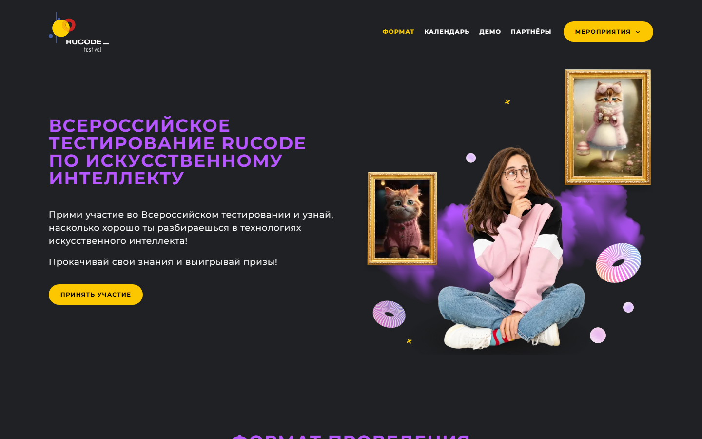
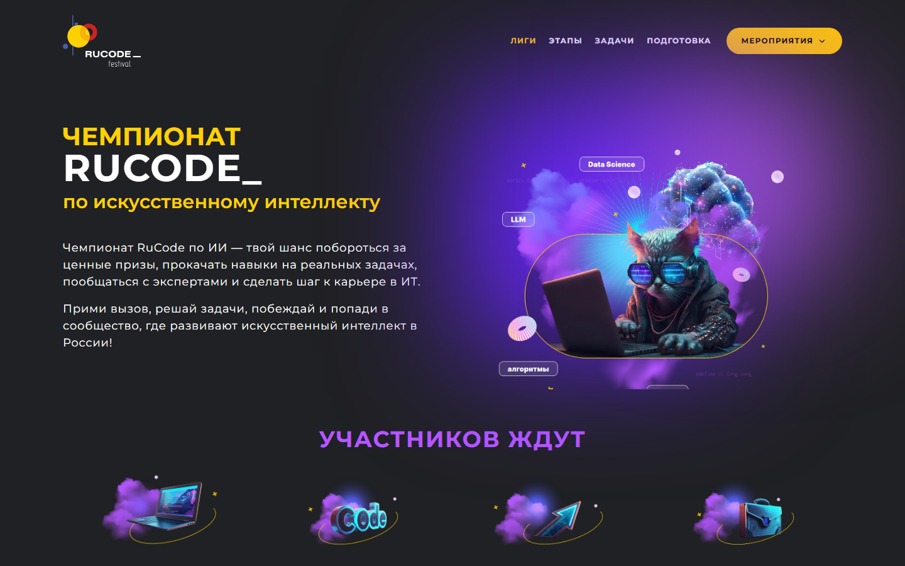
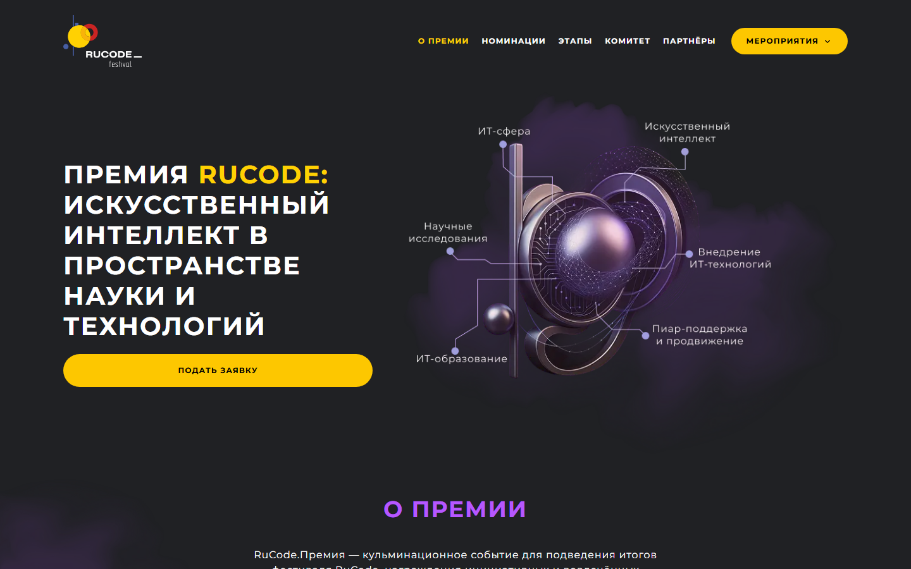
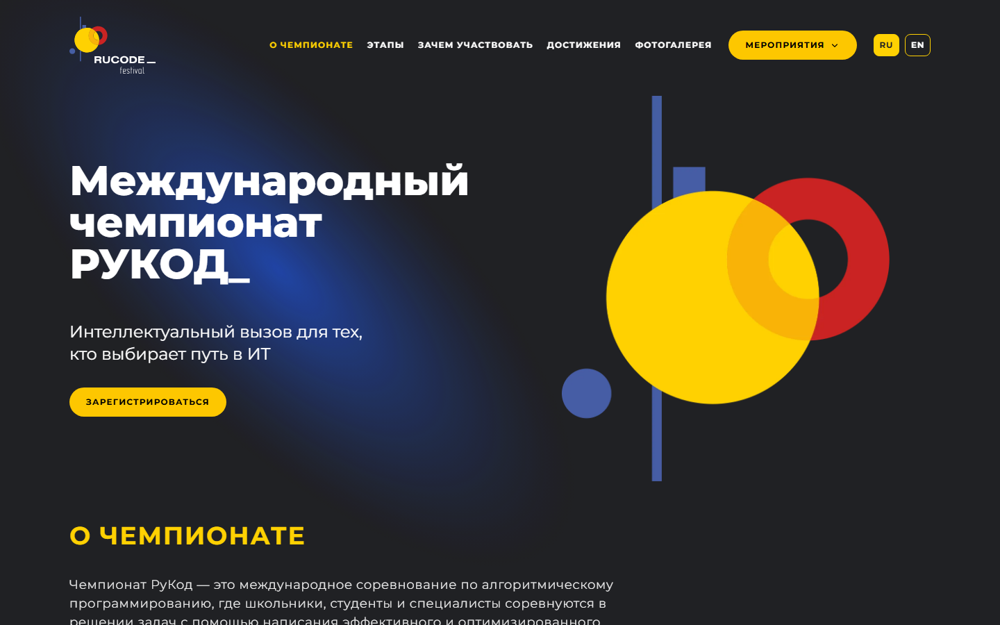

# RuCode

Сайт фестиваля RuCode: мероприятия, соревнования, образовательные программы и проекты в области искусственного интеллекта и программирования.

[Официальный сайт](https://rucode.net/) · [Демо проекта](https://tanzihaosin.github.io/rucode/) · [Быстрый старт](#быстрый-старт) · [Интеграция с CMS](#интеграция-с-cms-crito)



## О проекте

Сайт объединяет страницы фестиваля и его мероприятий: тестирование по ИИ, чемпионаты, премию, практикум и консорциум. Страницы состоят из самостоятельных блоков с типизированными данными. Содержимое, навигация и метаданные могут редактироваться в CMS Crito; для основных страниц предусмотрены локальные данные на случай её недоступности.

## Возможности

- Страницы мероприятий, информация об участии, этапах, партнёрах и результатах.
- Формы с проверкой данных и серверной передачей заявок в CMS при её подключении.
- Управление блоками страниц, шапкой, подвалом и SEO-метаданными через CMS.
- Предпросмотр черновиков из админки с подсветкой выбранного блока.
- Русская и английская версии страницы чемпионата по алгоритмическому программированию.
- Галереи, видео, слайдеры и ответы на частые вопросы.

## Скриншоты

**Чемпионат по искусственному интеллекту**



**RuCode.Премия**



**Международный чемпионат РуКод**



## Технологии

Nuxt 4, Vue 3, TypeScript, Tailwind CSS 4, Pinia, Nuxt Image, Nuxt i18n и Swiper. Для схем данных используется Zod; проверки и тесты построены на Steiger, TypeScript, Prettier и Vitest. Код организован по принципам Feature-Sliced Design.

## Быстрый старт

Понадобятся Git и Node.js 22 или новее; в CI используется Node.js 24.

```bash
git clone https://github.com/tanzihaosin/rucode.git
cd rucode
npm ci
npm run dev
```

Откройте <http://localhost:3000>. Перед запуском сервера `npm run dev` проверяет типы, архитектуру FSD и тесты. Без настройки CMS основные страницы работают на локальных данных. Для остановки сервера нажмите `Ctrl+C`.

## Как посмотреть проект

Откройте меню «Мероприятия» или перейдите непосредственно на страницы [тестирования по ИИ](https://rucode.net/aitesting), [чемпионата по ИИ](https://rucode.net/ai_champ), [премии](https://rucode.net/award2026) и [чемпионата по программированию](https://rucode.net/champ). Локально используйте те же пути на `localhost:3000`; английская версия чемпионата доступна по `/en/champ`.

## Интеграция с CMS Crito

Сайт получает страницы через серверный маршрут `/api/cms/<slug>`: CMS передаёт блоки, метаданные, шапку и подвал. При ошибке запроса или некорректном ответе основные страницы используют локальные блоки и настройки; страницы, существующие только в CMS, требуют её доступности. CMS отдаёт контент на русском, а английская версия чемпионата использует локальный перевод.

Для подключения скопируйте `.env.example` в `.env` и задайте нужные значения:

- `NUXT_CMS_BASE_URL` — публичный адрес API проекта CMS, например `<api>/public/rucode`.
- `NUXT_CMS_API_URL` — корень API CMS для медиатеки и прокси манифеста.
- `NUXT_REVALIDATE_SECRET` — секрет вебхука `POST /api/revalidate`, сбрасывающего серверный кэш страниц после публикации.
- `NUXT_CMS_CACHE_TTL` — время жизни кэша в секундах; `NUXT_PUBLIC_PREVIEW_ADMIN_ORIGINS` ограничивает адреса админки для предпросмотра.

Остальные параметры, включая необязательный прокси админки и Яндекс Метрику, описаны в `.env.example`. Секреты храните в локальном окружении, не в репозитории.

```bash
npm run manifest     # Создать .output/manifest.json для CMS
npm run block-shots  # Создать превью блоков в public/previews/
```

Для превью нужен Chromium от Playwright (`npx playwright install chromium`). Создавайте превью до манифеста и сборки: манифест включает пути к готовым изображениям. Реестр блоков и их схемы находятся в `src/app/block-registry/`.

## Проверка и публикация

```bash
npm run typecheck     # Проверка типов
npm run lint:fsd      # Проверка архитектуры FSD
npm test              # Тесты Vitest
npm run test:watch    # Тесты в режиме наблюдения
npm run format:check  # Проверка форматирования Prettier
npm run build         # Production-сборка
npm run preview       # Локальный просмотр сборки
```

Также доступны `npm run format` для форматирования и `npm run generate` для статической генерации. Production-сборка запускается командой `npm start` и требует Node.js. Серверный workflow запускается вручную: он проверяет FSD и тесты, собирает приложение, публикует его на тестовом и основном серверах и, если заданы секреты CMS, отправляет манифест блоков.

### Статическое демо на GitHub Pages

Отдельный workflow `.github/workflows/pages.yml` собирает демо из локальных данных и публикует `.output/public`. В настройках репозитория выберите **Settings → Pages → Build and deployment → Source: GitHub Actions**. Публикация запускается при изменениях в `main` или вручную через Actions. Workflow для серверов RuCode запускается только вручную.

В демо CMS, предпросмотр CMS и отправка заявок недоступны; формы показывают соответствующее уведомление. Страницы, созданные только в CMS, в статическую сборку не входят. Для локальной сборки с путём как у GitHub Pages задайте `NUXT_PUBLIC_STATIC_DEMO=1`, `NUXT_APP_BASE_URL=/rucode/` и `NUXT_IMAGE_PROVIDER=none`, затем выполните `npm run generate:pages`. Измените базовый путь, если имя репозитория другое.

## Структура

```text
src/
├── app/       маршруты, layout, стили, локализация и реестр блоков CMS
├── pages/     композиция страниц и локальные данные
├── widgets/   самостоятельные блоки страниц
├── features/  пользовательские сценарии
├── entities/  предметные сущности
└── shared/    общие компоненты, API и утилиты
server/        серверные маршруты и утилиты интеграции с CMS
public/        изображения, видео и другие статические файлы
scripts/       генерация манифеста и превью блоков
```

## Лицензия и связь

Лицензия в репозитории не указана. Вопросы о проекте можно обсудить в [репозитории на GitHub](https://github.com/tanzihaosin/rucode).
